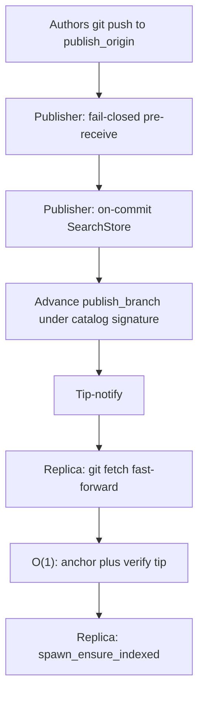
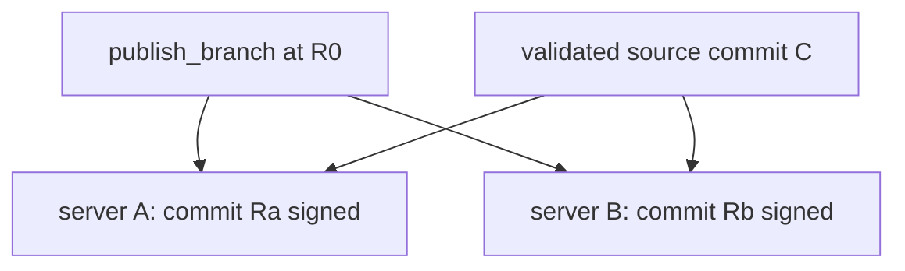
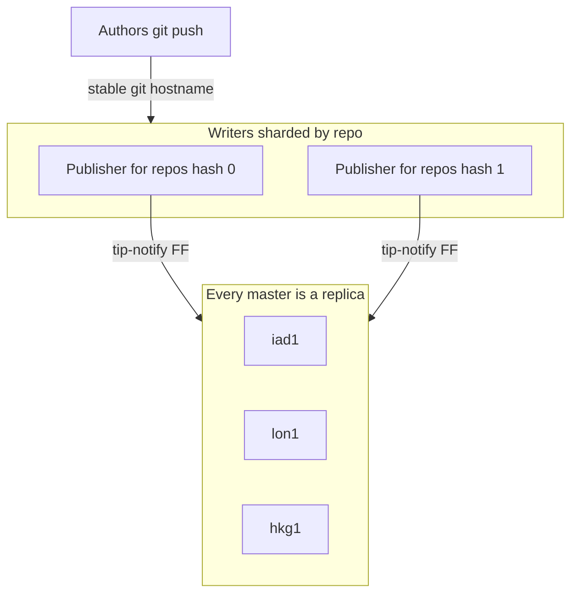
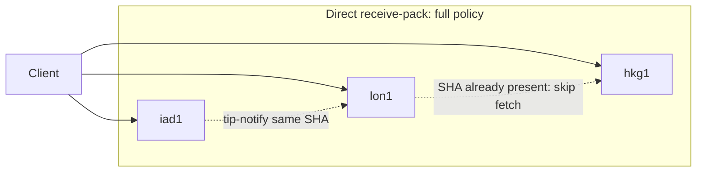

# Publish-once, on-commit index, replica skip (plan)

**Status:** client write fence is implemented (`enforce_publish_origin_fence` on `pre-receive` and HTTP PUT/DELETE). Replica skip (`enforce_push_range` on peer-fetch) is **not**. Gateways parse catalog `publish_origin` and reject client writes on non-publishers when the field is set. Empty/omitted = no fence (compat).  
**Settled product model:** **update the SearchStore on commit**, not on QUERY. QUERY / MCP are **read-only**. If `docs_indexed_head` lags the git tip, they return rows with **`indexFresh: false`** — they never JIT-rebuild.

**This fleet:** `publish_branch` is **`main`**. `publish_origin` is the fat publisher FQDN (e.g. **`pub1.relaygateway.net`** — a hostname, not a git branch — **never** `fleet.relaygateway.net`). Authors `git push` `main` to the publisher; mesh peers fast-forward `main`. Do not add a second publish ref. The publisher also owns the **`relay-ssr-cache` bake queue**; mesh peers only fetch that bare ([`RELAY_NETWORK_DNS.md`](./RELAY_NETWORK_DNS.md), [`RELAY_MESH_OPS.md`](./RELAY_MESH_OPS.md)). **Mesh tip sync ≠ SearchStore sync** — index is per-node after tip accept.

This document analyzes a **publish-once** mesh: run the expensive full cycle **once** on the publishing node, advance `publish_branch` under an existing catalog signature, let replicas **take Git immediately**, and **warm each replica’s SearchStore in the background**. It does **not** propose a new server signing key.

**Related:** [`QUERY_CLEVERSCRIPT.md`](./QUERY_CLEVERSCRIPT.md) (on-commit store), [`SERVER_HOOKS.md`](./SERVER_HOOKS.md) (hooks), [`RELAY_CATALOG.md`](./RELAY_CATALOG.md) (`publish_branch`, catalog signers), [`RELAY_MESH_NETWORKING_PLAN.md`](./RELAY_MESH_NETWORKING_PLAN.md) (validation vs blind trust), [`RELAY_POLICY_AND_PERFORMANCE.md`](./RELAY_POLICY_AND_PERFORMANCE.md), [`RELAY_MESH_OPS.md`](./RELAY_MESH_OPS.md), [`RELAY_AUTH_PROTOCOL.md`](./RELAY_AUTH_PROTOCOL.md).

**GitLab / forge is not in this path.** Policy, SSH commit verify, and CS `pre-receive` run only on **Relay** (`relay-hook-handler` / peer-fetch). The forge does not perform those checks and is not a `publish_origin`. Catalog rescue already treats GitLab as detached ([`RELAY_CATALOG_RESCUE.md`](./RELAY_CATALOG_RESCUE.md)). Authors `git push` **`git://` on the catalog publisher**, not GitLab.

---

## Why this exists

Two costs grow with complicated `.relay.yaml` / CleverScript rules and with mesh size:

1. **Per-commit policy (“blockcheck”)** — [`enforce_push_range`](../src/git/branch_policy.rs) walks every newly introduced SHA in `old..new` (`git verify-commit`, yaml, binaries, catalog signer rules). Optional CS `pre-receive` then runs **once per ref** (tip-to-tip `ctx.files`). **Every mesh hop re-runs this today** (peer-fetch after `git fetch`; auto-push hits full `pre-receive` again).
2. **On-commit SearchStore ingest** — [`ensure_indexed`](../src/git/indexing.rs) writes the node-wide SQLite catalog ([`.relay_search.db`](../src/git/search_store.rs)). This is a **tip snapshot** keyed `(repo, branch)` + `docs_indexed_head`, **not** a SQLite file per historical commit.

JIT-on-QUERY is **out**. The old idea in [`archive/REPODB_PLAN.md`](./archive/REPODB_PLAN.md) §5 (QUERY blocks until incremental index catches `HEAD`) is superseded: [`query.rs`](../src/git/query.rs) never rebuilds. So “don’t block Git, we’ll index when someone searches” is **not** available as a QUERY strategy. The only remaining knobs are **when** on-commit ingest runs relative to the git ACK, and **whether replicas re-execute policy**.

---

## Settled: update-db-on-commit

| Path | Writes SearchStore? | Blocks git client? | QUERY |
|------|---------------------|--------------------|-------|
| Origin `git push` → `pre-receive` | No | **Yes** (must reject) | n/a |
| Origin `pre-receive` (catalog `publish_branch`) | **Yes, `ensure_indexed_with_retries` — fail-closed** | **Yes** (reject tip if warm fails) | Tip does not advance without SearchStore stamp |
| Origin `post-receive` | **Yes, retrying `ensure_indexed`** (idempotent) | Side effects after ACK | Safety net |
| Peer-fetch (`POST /hooks/peer`) | **Yes, `spawn_ensure_indexed` + retries** | No (HTTP returns; ingest in a thread) | `index_pending` / `index_last_error` on status until warm |
| HTTP PUT/DELETE | **Yes, `ensure_indexed_with_retries` after tip** | Blocks HTTP success | Closes former “PUT never warms” gap |
| Catalog apply / `POST /api/index/warm/:repo` | Yes, sync | Not a git client | HTTP waits on warm |
| QUERY / MCP | **Never** | n/a | Read-only |

Implication: **every node that should answer QUERY with `indexFresh: true` still runs ingest after it accepts the tip.** Async only moves that work off the receive ACK. It does not delete the work.

Publish-origin mesh wait remains **git-tip only** ([`RELAY_MESH_OPS.md`](./RELAY_MESH_OPS.md)). Catalog `publish_branch` pre-receive is fail-closed on SearchStore; peer-fetch warms asynchronously with `index_pending`.

---

## Target flow



1. **Publisher** runs the full policy cycle (Rust range + optional CS `pre-receive`). Optionally waits for local SearchStore warm if “this node’s QUERY is part of publish.”
2. **`publish_branch`** (this fleet: **`main`**) only accepts a **catalog-active** signature — already the hosted merge rule (`merge_into_target_requires_catalog_signer`).
3. **Replicas** fetch immediately. They do **not** re-walk `old..new` or re-run CS `pre-receive`. They still do **O(1)** FF + `relayRootCommit` + **one** `git verify-commit` of the **tip**.
4. **Each replica** then `spawn_ensure_indexed` for **its** SQLite file. Git objects are already in the store; blob GET does not wait. QUERY may show `indexFresh: false` until warm finishes.

Git data plane and QUERY catalog stay separate. Serving on-tree files never required the database.

---

## Verdict on “server signs a new release commit + new secret”

The **shape** is right: one gate, then distribute a small trust object.

Do **not** take as-is:

| Idea | Problem |
|------|---------|
| **New leakable server key** whose only job is “this range was checked” | Same trust class as the **catalog signing key** you already have. A second key doubles rotation and leak surface. Compromise of one publisher then poisons replicas *by design* if they skip content/CS/binary walks. |
| **Server-made extra commit** on every publish | Needed only if you want a merge-bot (authors push `dev`, the **Relay publisher** squash-merges onto `publish_branch`). If the author already catalog-signs the publish tip, **that commit is the attestation**. |
| **Skip all replica checks** | Contradicts [validation, not blind trust](./RELAY_MESH_NETWORKING_PLAN.md). Keep FF, anchor, tip signature. Skip the N-commit walk and CS policy. |
| **Mesh HMAC as content trust** | `RELAY_PEER_SECRET` authorizes notify/fetch, not objects. `git://` is unauthenticated. |

**Preferred attestation:** catalog signer on `publish_branch`. The signing key stays with the **author or the designated Relay publisher node**, not GitLab, and **not** on every master. Replicas cheap-verify the same public keys already in `catalog/repos/<repo>.json`.

Independent per-server merge commits are **not** race-free — see **§ Independent server merges** below.

---

## Independent server merges — inconsistent history

**No.** If every Relay **creates its own signed merge (or squash) on `publish_branch`**, you get divergent tips. `receive.denyNonFastForwards=true` then **refuses** the other side. That is not a timing bug you can sleep away; Git commit IDs are not a consensus protocol.



`Ra` and `Rb` can share the **same tree** and the **same parents** and still be **different SHAs**:

- Committer date / host / message differ.
- SSH/GPG signatures are **not** a pure function of the payload (timestamps, nonces). Two `git commit -S` with the same key are almost never the same object.
- Different catalog keys per server make the split guaranteed.

Mesh fetch is **fast-forward only** (no `+` on peer-fetch). After A lands `Ra`, B cannot FF `Rb`; A cannot FF `Rb`. Split-brain on the publish branch until a human reset (catalog / operator).

### The parent race is worse than the signature race

Even a hypothetical deterministic commit object still races on **parent**:

1. A and B both see `publish_branch = R0`.
2. A publishes `R1` from source `C1`; B publishes `R1'` from `C2` (or from the same `C1` after a non-deterministic sign).
3. First CAS wins. The loser is not “eventually consistent”; it is **stuck** unless it **throws away** its merge and rebuilds on the winner.

That is **single-writer with retry**, not independent merging.

| Approach | Same source `C` on two nodes | Two different sources at once |
|----------|------------------------------|-------------------------------|
| Each server `commit -S` onto `publish_branch` | **Diverge** (`Ra` ≠ `Rb`) | **Diverge** |
| Deterministic `commit-tree` (no unique sig) | Same SHA **only if** same parent | **Diverge** on parent |
| FF `publish_branch` to already-signed `C` (`update-ref` CAS) | **Same SHA** — no new object | One wins; loser must rebase/retry or reject |
| One writer (the catalog `publish_origin` Relay) | No race | Serialized by that writer |
| CAS + remake merge on fetch (merge-bot queue) | Loser sees `C` already in `publish_branch`, **skip** | Linear history if loser **replays** on new parent |

### Race-free promotion (recommended)

Do **not** mint a new commit on each master. After the gate:

```text
update-ref refs/heads/main <already-signed C> <expected-old>
```

All nodes that accept `C` point `publish_branch` (`main` here) at the **same** OID. Content-addressing is the consensus. Compare-and-swap on `expected-old` so a stale publisher does not clobber a newer FF tip.

If `C` is not a descendant of current `publish_branch` (two drafts), **reject** or send it to **one** merge-bot — do not let every node invent a merge commit.

### If you still want a server-made merge

Then there must be **exactly one writer** for that repo’s `publish_branch` (the catalog `publish_origin` node). Other Relays only **fetch + FF**. They may all **validate** `C`; they must not all **commit**.

A retry loop (“fetch `publish_branch`, merge, push FF, on reject retry”) is fine for **one** bot with concurrency. It is not “every master independently publishes.”

---

## Scaling a single publisher

**One writer per publish ref — not one Relay for the whole mesh.** Reads, `git fetch`, HTTPS, and QUERY already scale by adding replicas. What must stay singleton is **who may advance `publish_branch` for a given repo**.



### What actually bottlenecks

| Load | Scales how |
|------|------------|
| Blob GET / site HTTPS | Any replica; CDN. Not the publisher. |
| QUERY | Local SearchStore on each node (on-commit ingest). Add nodes. |
| `git fetch` of objects | Any replica that has the pack. Mesh already does this. |
| Full policy + optional merge onto `publish_branch` | **One writer per that ref.** Git FF is sequential for a single branch anyway. |
| Many repos publishing at once | **Shard writers by repo**, not multiple writers on the same `publish_branch`. |

A single Git branch is a single-file log. Two active mergers on the same `publish_branch` do not increase throughput; they fork history. Scale publish **rate across repos**, and scale **serve** with replicas.

### Patterns (they compose)

**1. Catalog-designated publisher per repo (chosen)**  
`catalog/repos/<repo>.json` has `publish_origin` (FQDN). That master is the only node that accepts client `receive-pack`. Other masters refuse client pushes and only FF-fetch. Pin to the master closest to the **author’s** `git push` (see **§ How `publish_origin` is chosen**).

**2. Hash shard**  
`publisher = masters[hash(repo) % N]` as a catalog default when the owner has no region preference. Catalog override for stickiness. Adding a master **must not** move a live `publish_branch` writer without a drain (see failover).

**3. Draft anywhere — not chosen**  
Users `git push` `dev` to the nearest node, only `publish_origin` advances `publish_branch`. Conflicts with “non-publisher rejects all client `receive-pack`.” Leave off unless draft-anywhere becomes a product requirement.

Do **not** use GitLab/CI as the writer. The forge cannot run `enforce_push_range` or CS hooks.

Do **not** do “regional publishers all merge the same `publish_branch`.” That is § Independent server merges with extra latency.

### Failover (active-passive, never dual-active)

The writer is a **role**, not a unique machine for life.

1. **Fence the old writer first** (catalog `publish_origin` change, disable its key, stop `relay-gateway` / hook handler on that host). If the dead node comes back still holding the key, it will mint a sibling commit.
2. **Then** assign a new `publish_origin`.
3. New writer **fetches** current `publish_branch` before promoting anything.

A lease/heartbeat is optional later. Dual-active “both think they are publisher” is the race. Majority election without fencing is not enough.

### What a single writer can still handle

One process can serialize many repos (different refs, concurrent). One hot repo is limited by tree size and policy cost, not by “we only bought one Linode.” If one repo’s publish rate saturates a box, split the **repo**, not the **branch**.

Fleet today (three masters) is already this shape once each repo has a `publish_origin`: the other two are replicas. Growing to tens of masters does not require tens of writers per repo.

**Chosen direction:** per-repo publisher identity + stable git hostname; non-publishers reject **client** `receive-pack`. Details in the next section.

---

## Per-repo publisher and DNS failover

Yes: each repo names **one** primary publisher; clients use a **stable hostname** that DNS (or L4) points at that node; **failover moves the name after fencing**. Replicas **reject client pushes**, not mesh fetch.

### Source of truth: catalog only (settled)

**`publish_origin`** lives on **`catalog/repos/<repo>.json`**, next to `publish_branch` / `signing_keys`. Failover is a signed catalog commit (then DNS), not a push to the content repo.

Safer than `.relay.yaml` because:

- Catalog already gates who may sign and which node may serve the name (`relayRootCommit`, `domains[]`).
- Changing the writer requires the **catalog** allowlist (network-admin / catalog signers), not a content-repo admin key.
- A compromised or merely sloppy content repo cannot retarget `publish_branch` at an attacker-controlled Relay.
- Every master applies the same catalog tip, so “who is publisher” cannot drift per replica the way a branch-tip yaml could.

**Do not add `git.publishOrigin` to `.relay.yaml`.** No hint, no override, no hybrid. Hosted already ignores repo `allowedKeys` when `signing_keys_source: catalog`; publisher identity follows that pattern with no exception for `primary`.

Each node compares catalog `publish_origin` to **`RELAY_PUBLIC_HOSTNAME`**. Match → may accept client `receive-pack` / HTTP PUT for that repo. Else → reject those; still apply peer-fetch.

### How `publish_origin` is chosen

Default **yes: pick the master closest to the author’s `git push`**, not closest to readers.

HTTPS / QUERY / `git fetch` already fan out to every replica (`fleet.relaygateway.net`). Publisher location only affects **write ACK** (policy + pack). A Tokyo author pushing to `jp-osa` is the win; a Tokyo *reader* of a US-published repo does not need `jp-osa` to be the writer.

Nuance:

- The **catalog signer** (network admin) records `publish_origin` in the catalog PR. The repo owner can *request* a region; they cannot set it from `.relay.yaml`.
- Operators may **rebalance** (hot node, dying Spot, capacity) the same way as failover — fence, then change the field. Closest is a default, not a lock.
- Hash-sharding is the fallback when nobody cares about region and you only want even writer load.
- **Not GitLab.** Pinning “closest to a runner” is out; the forge is not the pusher and does not run Relay checks.

Do not geo-DNS git write to “nearest of N” (anycast / multi-A). That is multiple writers again. One CNAME → one origin; pick that origin to be nearby.

### What to reject (and what must still land)

| Ingest | Non-publisher |
|--------|----------------|
| Client `git push` / `receive-pack` | **Reject** (all refs, or at least `publish_branch`; see below) |
| HTTP PUT / DELETE | **Reject** on `publish_branch` (and PUT in general if drafts are publisher-only) |
| `POST /hooks/peer` fetch | **Accept** (replica path; cheap tip verify + async index) |
| Catalog / `POST /git-pull` | **Accept** under existing anchor rules |

If non-publishers also reject peer-fetch, the mesh cannot replicate. “Takes a commit” means **untrusted client write**, not **already-published objects**.

**All client refs vs `publish_branch` only:** rejecting **every** `receive-pack` on non-publishers is the simpler model and matches “push the stable git URL.” Draft-anywhere is then off; `dev` also goes to the publisher hostname. Prefer that unless draft-anywhere is a product requirement.

### Implemented: client write fence

`enforce_publish_origin_fence` in [`branch_policy.rs`](../src/git/branch_policy.rs) compares catalog `publish_origin` to **`RELAY_PUBLIC_HOSTNAME`**. Called from [`relay-hook-handler`](../src/bin/relay-hook-handler.rs) **pre-receive** (before branch rules) and from HTTP PUT/DELETE. Peer-fetch (`POST /hooks/peer`) is **not** fenced.

Reject text names the catalog `publish_origin` FQDN so authors push `git://iad1.relaygateway.net:9418/{repo}.git` (or a later per-repo git CNAME), **not** `fleet.relaygateway.net`.

**`git.autoPush.originList` to other masters is incompatible.** Auto-push is client `receive-pack` on the destination, so a replica with a `publish_origin` fence **rejects** it. Keep replica replication on **tip-notify + fetch** (`POST /hooks/peer`). Do not list other masters in `autoPush.originList` for catalog-fenced repos.

Git write DNS (`git.<repo>.relaygateway.net` CNAME → origin) is **not** required for the fence; see [`RELAY_NETWORK_DNS.md`](./RELAY_NETWORK_DNS.md).

### Subdomains: client convenience, not the fence

[`RELAY_TRUST_AND_BOOTSTRAP.md`](./RELAY_TRUST_AND_BOOTSTRAP.md): **`git://` has no HTTP redirect.** A stable name is DNS/L4 only.

**Do not** point git push at **`fleet.relaygateway.net`**. That multi-A set is for HTTP parked sites (any replica can serve). After reject-on-non-publisher, round-robin git push **fails on every replica it hits**.

Use a **per-repo** git hostname whose A/CNAME is **exactly** the current `publish_origin` node:

```text
git.paradigm-threat-files.relaygateway.net  CNAME  iad1.relaygateway.net
```

Client remote stays:

```text
git://git.paradigm-threat-files.relaygateway.net:9418/paradigm-threat-files.git
```

(`git://` still has no virtual Host: the subdomain only selects **which IP**. The path is still `/<repo>.git` on that daemon.)

HTTP `Host: {repo}.{node}` and parked `domains[]` stay on **fleet** (read any replica). Git **write** DNS is a different record set, reconciled like [`RELAY_NETWORK_DNS.md`](./RELAY_NETWORK_DNS.md) `fleet-dns`, but **one A/CNAME per repo**, not the full fleet set.

A single apex `git://relaygateway.net/<repo>.git` only works with an **L4/path router** in front of 9418 that forwards by repo to `publish_origin`. Wildcard DNS alone cannot do that: git daemon does not read the repo out of the hostname unless you add a proxy.

Low TTL (already ~60s on fleet recovery) on the git CNAME. Stale clients hitting a **fenced** old publisher should get **reject**, not a second writer.

### Failover order (behind the scenes)

DNS must not move until both nodes agree who the writer is.

1. **Fence:** catalog commit sets `publish_origin` to the new FQDN. Wait until **old and new** have applied it. Old `receive-pack` now rejects; new is ready. Publish is briefly unavailable if DNS still points at old — that is correct.
2. **DNS:** point the per-repo git CNAME at the new node (`relay-fleet.sh` / same reconciler).
3. New writer **fetches** current `publish_branch` before accepting promotions.
4. If the old VM returns from the dead, it is already a replica (catalog) — no sibling merge.

Never: DNS first while old still believes it is publisher. Never: two CNAMEs / multi-A on the git write name.

### `relay-master` itself

The catalog repo needs its own `publish_origin` (a Relay master). Failover of the catalog writer is the same fence-then-DNS procedure; do not special-case it into dual-active or through GitLab.

---

## The irony: must replicas still touch DB and hooks?

Under **update-db-on-commit**, split the planes:

| Work | Needed to accept Git? | Needed for `indexFresh: true` QUERY? | Sync with git ACK? |
|------|----------------------|--------------------------------------|--------------------|
| Pack + fast-forward | Yes | No | This *is* Git |
| Per-commit policy / CS `pre-receive` | Only if you do not trust the sender | No | Sync **at the publisher**; skippable on replicas after cheap tip check |
| CS `index` + SQLite ingest | **No** | **Yes**, on every QUERY-serving node | **May be async** vs ACK; **must still run** on each node (no QUERY JIT) |
| Blob GET / HTTPS of tree files | No (git show) | No | n/a |

**Half true:**

- **Git fetch does not need the database.** Replicas can serve blobs with a stale `.relay_search.db`.
- **QUERY-serving replicas still pay ingest CPU** after every tip move. You cannot skip that forever and wait for QUERY. The win is **not serializing ingest with `git push` / `git fetch` ACK**, plus **not re-running policy hooks** on hops 2+.
- **CS `pre-receive` does not run on replicas** in the target model. Complicated content rules belong at the gate. That is real savings, not irony.
- If the publisher **waits** for `ensure_indexed` before considering publish done, **that** node still serializes Git + DB once. Consumers do not.

Each node has its own SearchStore. Origin ingest does not replicate to peers; git objects do. Replica ingest is local derivation from the same tip.

---

## Options (cheapest first) — not implemented here

### A. Origin ACK vs on-commit index (no trust change)

Move origin `post-receive` to `spawn_ensure_indexed` so it matches peer-fetch. Align [`RELAY_MESH_OPS.md`](./RELAY_MESH_OPS.md). QUERY on the origin may lag (`indexFresh: false`) for the duration of ingest.

Keep this **opt-in per publish** if operators want “push ACK means local QUERY is fresh” on the publisher only.

Prefer tip-notify over `git.autoPush`: auto-push re-runs full `pre-receive` on the destination.

### B. Cheap replica verify (no new commit, no new key)

After FF fetch in [`peer_hook.rs`](../src/peer_hook.rs): if the **new tip** verifies against catalog **active** keys (one `git verify-commit`) and the parent is already present, **skip** `enforce_push_range` over the whole `old..new`. A 200-commit catch-up becomes 1 verify + FF + anchor instead of 200 process-spawn verifies **on every master**.

This proves “an allowed publisher signed the tip,” which is the same claim a server-made commit signed with that key would prove. It does **not** re-prove CS hooks ran.

Still `spawn_ensure_indexed` on the replica (on-commit model).

### C. Gated `publish_branch` (optional merge on the Relay publisher)

Authors `git push` `main` to `publish_origin` (full policy on that node). Only a catalog-signed tip advances `publish_branch` — either the author’s signed commit (FF `main` to `C`) or a **single** merge/squash **on that same Relay**, never on GitLab.

Other Relays must **not** independently `commit -S` onto `publish_branch` — that forks history (**§ Independent server merges**). They only FF-fetch. Scale by **sharding the writer role across repos** and adding replicas, not by a second live merger (**§ Scaling a single publisher**).

### D. Ingest performance (independent of mesh trust)

Even with A–C, each QUERY node still rebuilds derived state:

- `content_events` is a **full** walk today ([`catalog_build.rs`](../src/git/catalog_build.rs)).
- Catalog-apply warm often uses `old_commit = ZERO_OID` (full rebuild).
- Incremental `path_tree` / meta.yaml / chat already exist when `old_commit` is real.

Do **not** introduce per-commit SQLite files.

### E. Out of scope / reject

- Skip FF, anchor, or tip signature on replicas.
- Treat mesh HMAC as commit trust.
- Restore QUERY JIT so replicas can skip on-commit ingest.
- Put the catalog private key on every master so any node can mint publish commits.
- Use GitLab/CI as `publish_origin` or as a substitute for `pre-receive` / `git verify-commit`.

---

## Pushing to multiple remotes at once

`git push iad1 ord1 hkg1` (or a parallel `xargs -P` / `push.parallel`) does **not** go through the mesh. Each URL is a separate `receive-pack`. From Git’s point of view **every listed remote is a publisher**, not a replica. Publish-once only applies to nodes that **learn the tip via peer-fetch**, not via the client’s pack.

[`RELAY_MESH_OPS.md`](./RELAY_MESH_OPS.md) already says push **one Relay at a time** and let the mesh catch up. That becomes the **intended** client path under this plan, not just a hung-push workaround.



### Same SHA to every remote (the usual “push all the masters”)

| Layer | What happens |
|-------|----------------|
| **Policy** | Full `pre-receive` **per remote** (today and under the recommended rule below). Wall clock ≈ **slowest** remote, not the sum, if the client pushes in parallel. Sequential `git push a && git push b` pays the sum. |
| **On-commit index** | **Each** node still ingests into **its** SearchStore. That work is not shared. Parallel multi-push means N concurrent ingests of the same tree. QUERY-fresh on all hosts still costs N× CPU. |
| **Mesh** | Each successful `post-receive` tip-notifies. Peers that **already have `new_sha`** skip fetch ([SHA-first](./RELAY_MESH_NETWORKING_PLAN.md)). Extra HTTP chatter, not extra pack transfer. Slack `commit_update` already has cross-server dedup. |
| **Auto-push** | If `originList` is on, a multi-remote client push **plus** auto-push can stampede. Keep auto-push off; tip-notify is enough. |

So the client who fans out Git **opts out** of hop-skipping. They still get SHA-idempotent mesh, but they pay full policy (and, if origin ACK waits on ingest, full index) on every remote they touched.

### Recommended rule: trust the **ingest path**, not “I pushed this SHA elsewhere”

Anonymous `git://` has no client identity. A laptop hitting three remotes is indistinguishable from three independent untrusted pushes. Therefore:

- **`receive-pack` / direct `git push`:** always the **full** cycle (Rust range + CS `pre-receive`). Do **not** cheap-skip because the tip is catalog-signed or because another master might have checked it. Catalog signature does **not** prove CS ran.
- **`POST /hooks/peer` fetch:** option B cheap tip verify + `spawn_ensure_indexed`.

That way “push one publisher, mesh replicates” is fast, and “push every master myself” stays correct and merely expensive. If cheap-skip also applied to `receive-pack`, anyone with the catalog key (or a forged pack that verifies) could land content that **never** ran CS on **any** node, just by pushing the signed tip to all remotes and never hitting a gate.

### Divergent tips (different SHAs on different remotes)

Pushing **different** commits to different remotes is the existing fast-forward split-brain. Mesh fetch without `+` will **fail** on the lagging side. Publish-once does not heal that. Two merge-bots minting two publish commits is the same failure. One catalog `publish_origin` is the fix; catalog (not GitLab) remains the human reset path.

### Draft vs `publish_branch`

Multi-remote to **`dev`** is the same story: each direct push is a full check. There is no “I already pushed iad1, so ord1 can skip.” For **`publish_branch`**, only `publish_origin` accepts client `receive-pack`; other remotes reject. Authors use the stable git hostname, not a list of masters, and not GitLab.

### What not to do

- Wait for all remotes’ SearchStores before ACKing the first push.
- Skip replica ingest because “the publisher already indexed” — each node’s DB is local (on-commit model).
- Treat parallel multi-push as a substitute for the mesh. It duplicates policy and ingest on purpose.

---

## What already exists (do not reinvent)

- Catalog `publish_branch` (this fleet: **`main`**) and catalog-authoritative `signing_keys`. A different `publish_branch` name is a per-repo override, not a mesh-wide second ref.
- Merge onto publish must be catalog-signed.
- Policy I: only **newly introduced** commits are checked; objects reachable from `old` are not re-walked. A **single** new publish commit is already a 1-SHA check if the parent is present.
- Peer-fetch: SHA-first skip if already at `new_sha`; index already async.
- QUERY envelope: `indexFresh`, `indexedHead`, `status`.

The remaining gaps are **hop 2+ still full-range policy** and **origin ACK still waits on ingest**. **First-push provision** is live (`relay-git-proxy` on **9418**, loopback `git daemon` on **9419**).

---

## Implementation notes (when prioritized)

Client write fence is done. Suggested order **after** that:

0. **First-push provision** — done. `relay-git-proxy` parses `git://` receive-pack, calls the same logic as `ensure-bare` (plus `publish_origin`), then hands off to loopback `git daemon`. HTTP `POST /api/git/ensure-bare/:repo` remains for pre-create.
1. **A** — `post-receive` spawn index; docs/code agreement; HTTP PUT should call the same on-commit path if QUERY on that node must be fresh after PUT.
2. **B** — `peer_hook` cheap tip verify for catalog-signed `publish_branch`; keep full `enforce_push_range` for draft branches and for unsigned/`dev`.
3. **C** only if product wants a merge-bot **on the Relay `publish_origin`**; no GitLab writer.
4. **D** as profiling shows (`content_events`, catalog-apply `ZERO_OID`).
5. mTLS / realtime subscriptions.

Tests to add then: replica accepts a catalog-signed publish tip without walking ancestors; replica QUERY `indexFresh` flips true after background warm; origin push ACK time does not include ingest when A is on; rejected unsigned publish tip still rolls back; **direct** `git push` of the same SHA to a second remote still runs full `pre-receive` (path-based trust); peer-fetch of that SHA is SHA-skip or cheap tip verify only.
